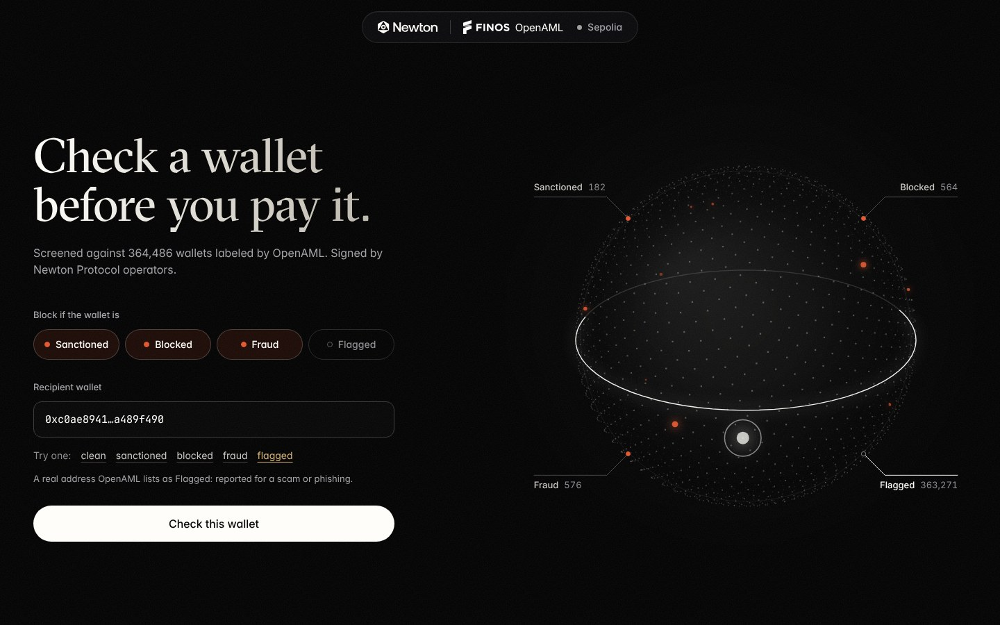
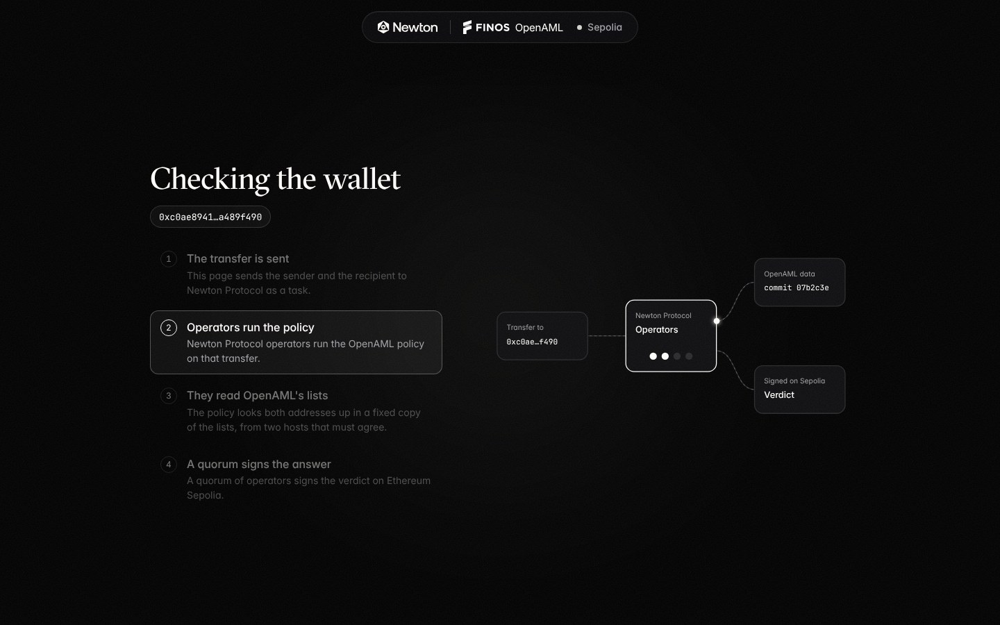

# Newton OpenAML Demo

**Newton Protocol × FINOS OpenAML.** Check a wallet before you pay it.

A visitor chooses which OpenAML lists should block a transfer and enters a
recipient. Newton Protocol operators screen the transfer against 364,486
wallets labeled by [OpenAML](https://github.com/finos-labs/dtcch-2025-OpenAML),
a FINOS Labs project, and a quorum signs one verdict on Ethereum Sepolia:
**Blocked** or **Allowed**.



## What it shows

- **A rule the visitor sets.** Four OpenAML lists, each switched to block or
  allow. Any mix works.
- **One signed verdict per check**, with a link to its attestation on the
  Newton Explorer.
- **The same wallet under a different rule.** From the verdict, flip a switch
  and run again. A wallet that was allowed can come back blocked, and both
  answers are signed.
- **Failing closed.** If the operators cannot read the data, the policy denies,
  and the page says "Not screened" in grey instead of accusing the wallet.

| OpenAML list | Wallets | Blocked by default |
| --- | ---: | --- |
| Sanctioned (on a government sanctions list) | 182 | Yes |
| Blocked (frozen by Tether or Circle) | 564 | Yes |
| Fraud (linked to an exploit or hack) | 576 | Yes |
| Flagged (reported for a scam or phishing) | 363,271 | No |

Flagged is off by default because those entries are community reports with no
source attached.



## How it works

```
page ─▶ /api/check ─▶ newt_createTask ─▶ client for the chosen lists ─▶ operators run the policy ─▶ quorum signs
                                                                              │
                                              index/shards at a pinned commit (GitHub, jsDelivr, githack)
```

**One policy, one client per rule.** The policy (`policy/openaml`) reports which
OpenAML lists each address is on. A client contract's on-chain params say which
lists deny. There are 15 clients, one for every mix of the four lists. The page
sends the chosen lists, and the server picks the matching client from
`policy/out/clients.sepolia.json`. The choice never reaches the policy as an
argument a submitter could change.

**The data.** `index/` is OpenAML's three files split into 4,096 small shards,
so the oracle fetches a few KB per check. The build changes the format and drops
17 addresses no one can own (the zero address, precompiles and decoding
leftovers in the Blocked list). Nothing is added or relabeled, and it rebuilds
byte for byte from OpenAML commit `07b2c3e` (see `index/README.md`). The oracle
reads the shards at one pinned commit of this repo, from two hosts that must
agree byte for byte. The data is a fixed snapshot: when OpenAML publishes new
lists, rebuild the index, move the pin and redeploy the policy.

**The policy fails closed.** Hosts down or disagreeing, a shard from the wrong
source, missing or invalid params, or an address the oracle did not screen all
deny. Both the sender and the recipient are screened and bound to the intent,
so a submitter cannot screen one address and pay another.

**The attestation decides; the page explains.** After the signed verdict, the
page looks the recipient up in the same index to say which list matched. That
lookup is unsigned and never changes the verdict. If the two disagree, the page
says so.

**Scope.** Native ETH transfers on Ethereum Sepolia. For a token transfer the
intent's `to` is the token contract, so this policy would screen the wrong
address.

## Deployed on Sepolia

| What | Address |
| --- | --- |
| Policy `newton_openaml` | [`0x395A67b71db090f1F36b93F2df00Da3c0F9e5995`](https://sepolia.etherscan.io/address/0x395A67b71db090f1F36b93F2df00Da3c0F9e5995) |
| Newton task manager | [`0xecb741F4875770f9A5F060cb30F6c9eb5966eD13`](https://sepolia.etherscan.io/address/0xecb741F4875770f9A5F060cb30F6c9eb5966eD13) |

Policy artifacts, as recorded by `newton-cli` in `policy/openaml/dist/policy_cids.json`:

| Artifact | CID |
| --- | --- |
| Rego | `bafkreiabdvtiamnctdy3f5c5cdg4tdef6dvdyyrrok4l3ic73l5ngmx4y4` |
| WASM oracle | `bafkreigauav2h7teuxkthn4gaaycldm2l3lciidezfuk76ydvrnpv67g5m` |
| Params schema | `bafkreidjicd5ric6gjj4yodnlfd3xjt7lf5fxs56m7pjlvbsaz3jq7fdsm` |
| Metadata | `bafkreici2kh2f5xo7e3yz6xx75x54zus3v6yc4p6mz6pqctlqhf2bfwxta` |

<details>
<summary>The 15 clients, one per rule</summary>

| Blocks | Client |
| --- | --- |
| Sanctioned | [`0xce542d7C2A3e88A0C888bc395f9d08c393bfA3FC`](https://sepolia.etherscan.io/address/0xce542d7C2A3e88A0C888bc395f9d08c393bfA3FC) |
| Blocked | [`0x8Fbf2D2697809D197852A38222cF4E706E31C30E`](https://sepolia.etherscan.io/address/0x8Fbf2D2697809D197852A38222cF4E706E31C30E) |
| Fraud | [`0x3942D0B6dE3438Ce75Ad1991498B090626086FA0`](https://sepolia.etherscan.io/address/0x3942D0B6dE3438Ce75Ad1991498B090626086FA0) |
| Flagged | [`0x445271510cfcf46e7F543B12024Ca65879fA8C0a`](https://sepolia.etherscan.io/address/0x445271510cfcf46e7F543B12024Ca65879fA8C0a) |
| Sanctioned, Blocked | [`0xD05821c63061163881cdD181bf06d736F84877aB`](https://sepolia.etherscan.io/address/0xD05821c63061163881cdD181bf06d736F84877aB) |
| Sanctioned, Fraud | [`0xc5478512c3d89f21175EBB8421684FAe3Bd3D815`](https://sepolia.etherscan.io/address/0xc5478512c3d89f21175EBB8421684FAe3Bd3D815) |
| Sanctioned, Flagged | [`0x2BCF91a240c3fa9A7D79715192229b98d6790CD2`](https://sepolia.etherscan.io/address/0x2BCF91a240c3fa9A7D79715192229b98d6790CD2) |
| Blocked, Fraud | [`0x93E98F254A8d1dD2137BA41C27ee8c15f0DaA291`](https://sepolia.etherscan.io/address/0x93E98F254A8d1dD2137BA41C27ee8c15f0DaA291) |
| Blocked, Flagged | [`0xDFdF23F72EE06D9F9d9e543208Ad42CBCD03540C`](https://sepolia.etherscan.io/address/0xDFdF23F72EE06D9F9d9e543208Ad42CBCD03540C) |
| Fraud, Flagged | [`0xE90F3c7534C0a94B59b29E98E18503Ad84E98eed`](https://sepolia.etherscan.io/address/0xE90F3c7534C0a94B59b29E98E18503Ad84E98eed) |
| Sanctioned, Blocked, Fraud | [`0x33494B509f7D29dC7D35D774DCae8F01B527266d`](https://sepolia.etherscan.io/address/0x33494B509f7D29dC7D35D774DCae8F01B527266d) |
| Sanctioned, Blocked, Flagged | [`0x32E32e8bEc04b4cEe2cc767FEA6393B606A89Aab`](https://sepolia.etherscan.io/address/0x32E32e8bEc04b4cEe2cc767FEA6393B606A89Aab) |
| Sanctioned, Fraud, Flagged | [`0x11310ab0a8E403a53341A29FcF517d07e0BA8523`](https://sepolia.etherscan.io/address/0x11310ab0a8E403a53341A29FcF517d07e0BA8523) |
| Blocked, Fraud, Flagged | [`0xDE23D0e12e86556fd827879B19D360d197B89AE7`](https://sepolia.etherscan.io/address/0xDE23D0e12e86556fd827879B19D360d197B89AE7) |
| Sanctioned, Blocked, Fraud, Flagged | [`0x1fe173D2DC06a575d0765114E84e4B5B0a30Bb8B`](https://sepolia.etherscan.io/address/0x1fe173D2DC06a575d0765114E84e4B5B0a30Bb8B) |

</details>

## Run it locally

Requires Node 20 or newer.

```bash
git clone https://github.com/newt-foundation/newton-openaml-demo.git
cd newton-openaml-demo
npm install
cp .env.local.example .env.local   # add your NEWTON_API_KEY
npm run dev
```

`NEWTON_API_KEY` comes from the Newton dashboard and stays on the server. Its
account's wallet must own the clients it submits to, so to run checks against
your own key, deploy your own policy and clients first (see below). Client
addresses are read from `policy/out/clients.sepolia.json`, not from environment
variables.

## Tests

```bash
npm run typecheck
node scripts/check-consistency.mjs                         # pins, samples and counts agree
node --experimental-strip-types scripts/test-outcome.mjs   # outcome and fail-closed rules

cargo install regorus --example regorus --root ./regorus-bin
REGORUS=./regorus-bin/bin/regorus node policy/openaml/test/run.mjs   # 37 policy cases on the Rego engine operators run

node scripts/compile-client.mjs                            # client ABI matches interface id 0xf67e14d6
npm i --no-save ganache @newton-xyz/sdk@1.2.2
node scripts/rehearse-deploy.mjs                           # full client deploy on a local chain
```

The policy cases cover each list under several rules, a listed sender, one host
down, every failure that must deny, and task arguments that try to swap the
recipient or the data source.

## Deploy your own

The oracle can only fetch the index once the repo is public on GitHub at the
commit pinned in `policy/openaml/policy.js`, so push first and never rewrite
history.

Then, on a Mac with `newton-cli` installed:

```bash
bash scripts/go-live.sh
```

The script runs each step in order and stops at the first problem:

1. Checks the index is served from GitHub and jsDelivr at the pinned commit.
2. Asks once for the owner key and the Newton API key, without showing them,
   and keeps them in the macOS Keychain. They are never written to the repo.
3. Builds the policy and simulates it: a clean wallet must be allowed, a fraud
   wallet and a flagged wallet must be denied.
4. Deploys the policy, then the 15 clients after a dry run.
5. Runs eight real checks and compares each with its expected outcome.
6. Sets the API key on Vercel, commits the deploy record and deploys the site.

Finished steps are recorded in `policy/out/` and skipped on a rerun. After a
change to the policy files, run `bash scripts/go-live.sh --new-policy`. To ship
a site-only change, run `bash deploy.sh "what changed"`.

## Repository layout

| Path | What |
| --- | --- |
| `app/`, `components/`, `lib/` | The Next.js site. `app/api/check/route.ts` submits tasks; `lib/outcome.ts` turns a verdict into an outcome |
| `policy/openaml/` | The policy: WASM oracle (`policy.js`), Rego, params schema, fixtures and tests |
| `policy/OpenAMLDemoClient.sol` | Protocol 0.7 policy client, with two-step ownership |
| `policy/out/` | Deploy record: the policy, the 15 clients and the compiled client |
| `index/` | The OpenAML lookup index, its build script and manifest |
| `scripts/` | Compile, deploy, rehearse, task test and consistency check |
| `.claude/skills/` | The design and motion rules this demo follows |

## Design

The page follows the `newton-demo-design` skill in `.claude/skills/`: the Newton
brand's Coal and Bone, GT Sectra Fine for headlines, and colour only as a soft
tint where it means something (red for blocked, green for allowed). The whole
demo is one screen at every window size.

## Licences and credits

- **OpenAML data:** Apache 2.0, Copyright 2025 FINOS. `index/` keeps the labels
  unchanged and credits the source commit. See `NOTICE` and `LICENSES/`.
- **Typeface:** GT Sectra is a commercial typeface from Grilli Type. The subset
  in `app/` is not covered by any licence in this repo; do not reuse it without
  your own licence.
- **Code:** no open-source licence has been chosen for the site and policy code
  yet. Until a `LICENSE` file is added, all rights are reserved.
- **Names and logos:** FINOS is a trademark of the Fintech Open Source
  Foundation. The Newton name and logo belong to Newton Protocol.
